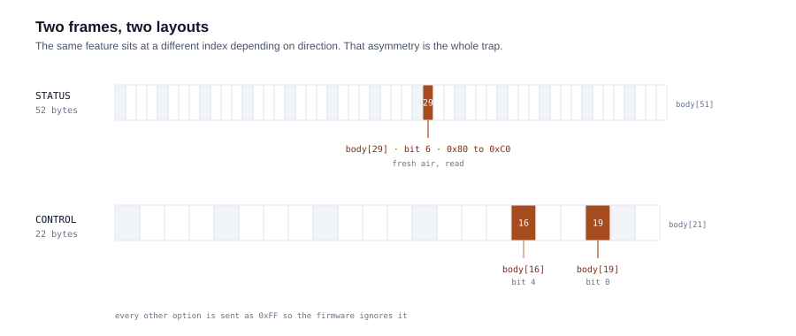

# midea-mf200-tools

[](https://github.com/santipaez/midea-mf200-tools/actions/workflows/ci.yml)

Reverse engineering notes and tooling for the local protocol of a Midea MF200
washer-dryer. The goal was narrow: run **fresh air** — fan plus slow drum
rotation, no water, no heat — as a standalone program.

The answer is that the hardware can and the firmware will not. This repository
documents the method, the exact protocol offsets, five strategies tested against
the physical machine, and why every one of them fails.

## The question

The MF200 advertises an "Air Fresh" routine. In the official app it only appears
after a completed wet cycle, as a maintenance step. The local protocol exposes
the flag, so the question was whether it could be triggered on its own.

## Method

1. **Discovery.** ARP scan, port scan. Port `6444/TCP` is exposed: the Midea V3
   local protocol.
2. **Telemetry.** `midea-local` with the device's local keys, reading the status
   frame in real time.
3. **Differential analysis.** Status frames captured before and after each action
   in the official app, diffed to isolate the bytes that change.
4. **Protocol audit.** The vendor's own Lua/JS definitions, downloaded from its
   CDN, used to confirm what each register means. The files are not redistributed
   here.
5. **Parametrised injection.** A tool that builds 22-byte control frames and
   sends them to the controller, then observes the physical result.

## Findings



| Signal | Direction | Location |
|---|---|---|
| Fresh air (`wind_dispel`) | read | bit 6 of byte 39 in the status frame (`body[29]`), `0x80` becomes `0xC0` |
| Fresh air (`wind_dispel`) | write | bit 0 of byte 29 in the 22-byte control frame (`body[19]`), write `0x01` |
| Steam (`steam_wash`) | write | bit 4 of byte 26 (`body[16]`), write `0x10` |

Two structural details matter more than the bits themselves:

- **Read and write use different frames.** Status arrives in a ~52-byte frame.
  Control is always a compact **22-byte body**, with every option you do not want
  set to `0xFF` so the firmware ignores it.
- **The offsets do not line up.** `body[29]` for reading and `body[19]` for
  writing point at the same feature from different positions.

## Results against the physical machine

| Strategy | Program | Injected | What the machine did | Outcome |
|---|---|---|---|---|
| A | `fresh_air` (`0x3C`) | temp 0, spin 0, wind dispel on | Rejected the ID, fell back to cotton (`0x00`), loaded water | Rejected |
| B | `single_dehydration` (`0x09`) | temp 0, spin 0, 1 min | Drained, rotated, stopped | Flag ignored |
| C | `quick_wash` (`0x02`) | wash 0 min | Ignored the zero, loaded water, ran 15 min | Rejected |
| D | `time_dry` (`0x82`) / `single_drying` (`0x16`) | dryer level 1, wind dispel on | Ventilated and rotated, **but energised the heating element** | Heats |
| E | `steam_care` (`0x6D`) | wash 0 min, wind dispel on | Ignored the zero, loaded water | Rejected |

## Conclusion

The controller enforces three rules in firmware, and none of them can be talked
around from the network:

1. Any wet program requires a minimum water level and rejects a zero wash time.
2. Any drying program energises the heating element; the temperature parameter is
   ignored for the heater, so cold-air drying is not reachable through it.
3. `wind_dispel` is a post-cycle routine. The firmware only schedules it after a
   compatible wet program finishes.

The limit is a firmware policy, not a hardware capability. The drum and fan do
run together without water in strategy D, which is why the conclusion is about
policy rather than capability.

## Disclosure

The finding was reported to Midea's product team in Argentina, with the decoded
state sweep and the frame evidence. They confirmed that firmware decisions for
this model are made globally rather than regionally, and escalated the report.
No response has followed, and no attempt was made to obtain firmware or to bypass
any protection.

## Scope and safety

- Everything here was tested on a device I own, on my own network.
- No firmware, vendor plugin, or vendor binary is redistributed in this
  repository.
- **Modifying the appliance is out of scope.** Reaching cold-air ventilation by
  switching the heating element would mean intervening on a mains-powered
  circuit in a wet appliance. That is not a recommendation and no instructions
  are provided. Read this as a protocol study, not a guide.

## Layout

```
tools/          numbered phase scripts, one per investigation step
tools/midea_config.py   device address from the environment, never committed
docs/protocol-map.md    offsets and frame layout
docs/notes-es.md        the working log, in Spanish, cleaned of secrets
captures/       empty on purpose: raw captures stay local
```

## Running

```bash
cd tools
pip install -r requirements.txt
export MIDEA_DEVICE_IP=192.168.1.50      # your device, not mine
python 01_network_scan.py
```

Scripts that talk to the device read `MIDEA_DEVICE_IP`. The cloud helper in step
04 authenticates with the account you pass on the command line and caches the
resulting token and key under `results/`, so the later phases can reconnect
without asking again. That directory is gitignored and it holds live keys: delete
it when you are done, and never commit it. Nothing secret ships in this
repository.

## License

MIT for the code in `tools/`. The protocol knowledge is published for
interoperability on hardware I own.
