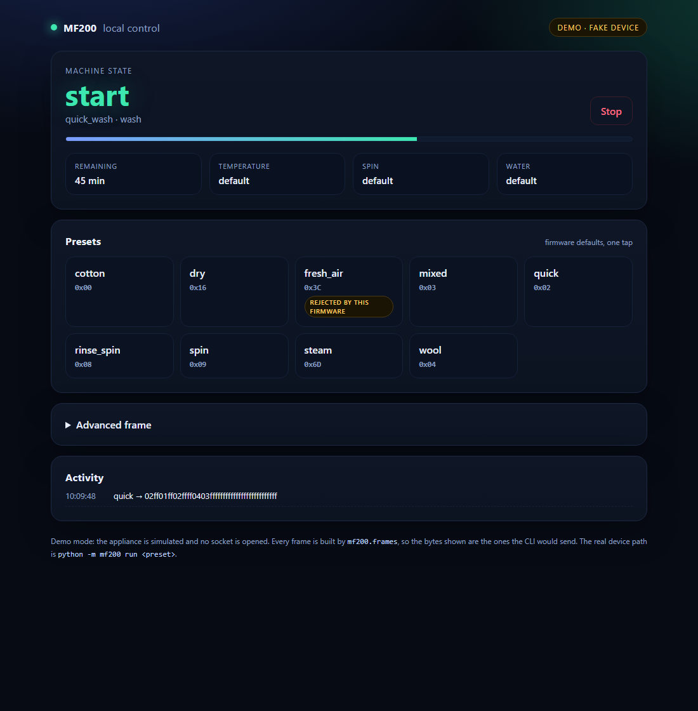
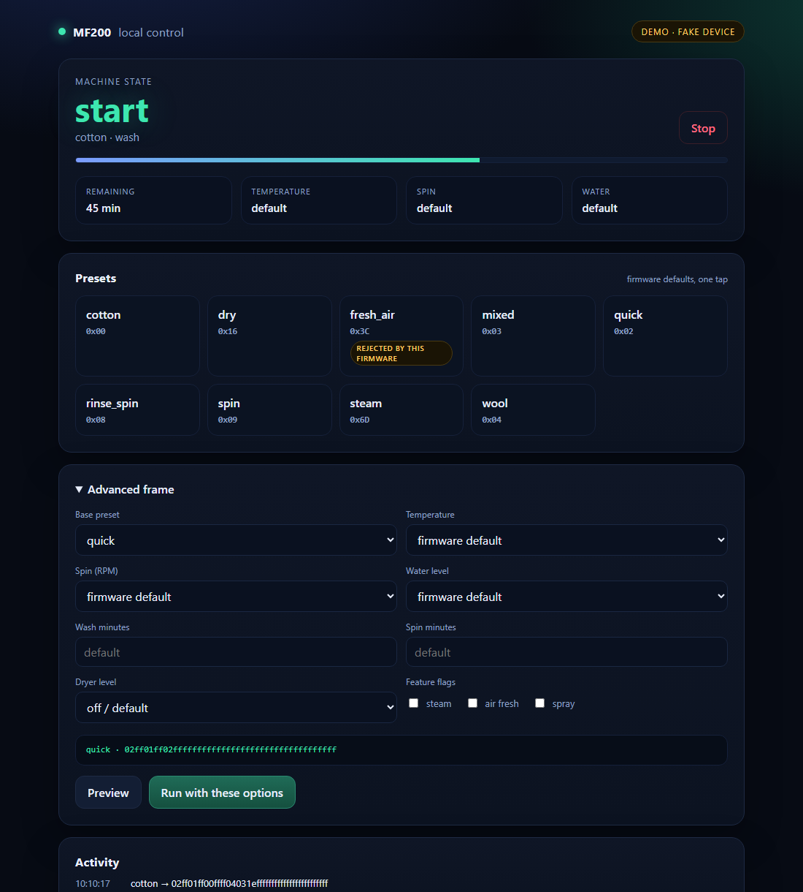

# Control layer

`mf200` is a small library and CLI that turns the protocol map into something
you can program against. It builds the 22-byte control body, validates the
values it can encode, and delegates transport to `midea-local`.

It exists because the frame layout was buried in the investigation scripts.
The builder, the presets and the frame documentation are the reusable part; a
UI is somebody else's fork, and there is a demo server here only to show what
that fork could look like.

## What it is not

- It does not bypass the firmware limit described in the README: `fresh_air`
  is still rejected, and the layer says so.
- It does not support other Midea models. The offsets and ids are this
  device's.
- It does not replace `midea-local`; it sits on top of it.

## Layout

| Module | Job |
|---|---|
| `mf200/frames.py` | `ControlOptions` → 22 bytes, with validation and the known enums |
| `mf200/presets.py` | the named programs (`quick`, `cotton`, `spin`, ...) |
| `mf200/device.py` | one appliance connection over `midea-local` |
| `mf200/cli.py` | `presets`, `frame`, `run`, `status`, `demo` |
| `mf200/demo.py` | fake device plus a local HTTP server for the UI |
| `mf200/web/index.html` | the demo page |

The frame builder has no third-party dependency. `midea-local` is imported
only when a real connection is opened, so `frame` and `demo` run anywhere.

## Quick start

```bash
python -m mf200 presets
python -m mf200 frame quick --temperature 40 --spin 800
python -m mf200 run quick --dry-run
```

`run` without `--dry-run` needs the credentials produced by
`tools/04_read_raw_bytes.py` (`tools/results/credentials.json`) and the device
address:

```bash
export MIDEA_DEVICE_IP=192.168.1.50
python -m mf200 status
python -m mf200 run quick
```

## Demo

```bash
python -m mf200 demo
# mf200 demo on http://127.0.0.1:8765 — fake device, no appliance is contacted
```

The demo serves the page, a fake appliance and the same frame builder the CLI
uses. It never opens a socket to the appliance. The page is responsive, so it
also works from a phone on the same network if you pass `--host 0.0.0.0`; do
that only on a network you trust.



The advanced panel exposes every option the builder supports and previews the
exact bytes before sending them.



## Using it as a library

```python
from mf200.frames import ControlOptions, build_control_body

body = build_control_body(
    ControlOptions(
        program="cotton",
        temperature=40,
        spin_rpm=800,
        wash_minutes=30,
        steam=True,
    )
)
print(body.hex())
```

Sending it is three lines:

```python
from mf200.device import Credentials, Device

device = Device("192.168.1.50", Credentials.load())
device.connect()
try:
    device.send(body)
finally:
    device.close()
```

## Validation instead of silent guesses

The builder raises on anything it cannot encode: an unknown program name, a
temperature outside the verified set, a spin speed outside the verified set, a
value that would collide with `0xFF`. A frame that looks plausible but carries
an invented code is worse than an error, because the firmware accepts it and
falls back silently.

## Testing

```bash
python -m unittest discover -s tests -t .
```

The tests are golden vectors: they assert the exact bytes for each option,
the `0xFF` default for everything untouched, the preset map and the demo
backend. No appliance and no `midea-local` install are needed.

## Extending

- **New preset**: add a `ControlOptions` entry to `PRESETS`. Keep the defaults
  at the firmware's; only set what you have verified.
- **New option**: add the field to `ControlOptions`, encode it in
  `build_control_body`, add a test with the exact byte.
- **Another model**: keep the frame builder and add a profile with that
  device's ids/codes. Do not reuse this device's offsets without checking
  them; the status and control layouts already differ inside one device.
